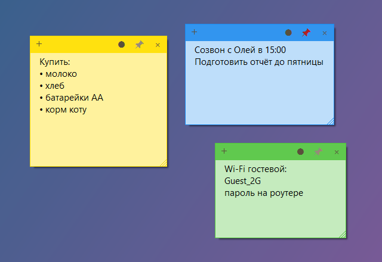

<div align="center">

# 🗒️ StickyNotes

**Заметки-стикеры на рабочем столе: быстро записать и не забыть**




</div>

## ✨ Возможности

- 🟨 Цветные стикеры прямо на рабочем столе: жёлтый, зелёный, голубой, розовый, сиреневый, серый
- 📌 Любую заметку можно закрепить поверх всех окон
- 💾 Всё сохраняется само: текст, положение, размер и цвет. После перезагрузки заметки на месте
- ↔️ Перетаскивай за шапку, меняй размер за края
- ⌨️ `Ctrl+N` создаёт новую заметку, двойной клик по иконке в трее тоже
- 🚀 Пункт «Запускать вместе с Windows» в меню трея
- 📁 Заметки хранятся в обычном JSON-файле в `%APPDATA%\StickyNotes`: легко сделать бэкап

## 💡 Когда пригодится

- Номер заказа, код или адрес, который нужен на пару часов
- Список дел на день перед глазами
- Подсказка поверх игры или видеоурока

## 📥 Установка

1. Скачай `StickyNotes.exe` из раздела [**Releases**](../../releases/latest)
2. Запусти его, установка не нужна

## 🛠️ Сборка из исходников

Нужен только Windows: компилятор C# входит в состав .NET Framework.

```bat
build.bat
```

## 📄 Лицензия

[MIT](LICENSE)
